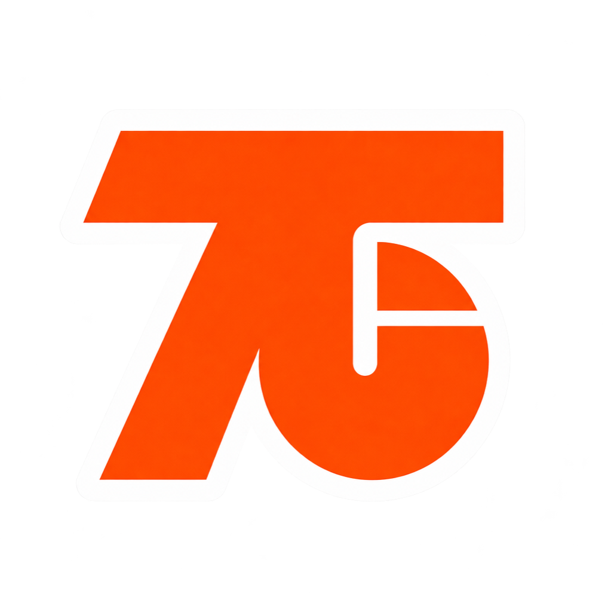

# TextureConverter · 1.0

<p></p>

> **正式版 1.0 / Release 1.0**　与 Mesh Converter 选择同一个 Mod 根目录，输出直接进入原有的 materials 和 textures 层级。设置可关闭磁盘报告。
>
> Use the same mod root in both tools. Materials and textures go directly into their game paths. File reports are optional and live progress stays available. [测试记录 / Validation](SECURITY_VALIDATION.json)


> **基础安全修订 / Included security revision:** `security-hardening-20261117` · ALPHA 1.0。399 项回归通过；见 [安全更新](SECURITY_REVISION_20261117.md)、[安全边界](SECURITY.md) 和 [构建记录](BUILD_PROVENANCE.json)。

> **历史动效验证 / Historical motion validation:** 2026-11-17 Pinterest motion. 启动 1400ms、关闭 650ms；323 项回归通过。详见 [MOTION_REVISION_20261117.md](MOTION_REVISION_20261117.md)。

> 历史记录：较早的 runtime-motion 更新共通过 315 项测试，保留在 [VALIDATION_20261117.md](VALIDATION_20261117.md) 供追溯；该动效阶段采用上方的 323 项验证；当前安全修订结果以上方链接为准。下文“本次整理／未运行”等陈述属于 10 月源码发布阶段的历史说明。

本地 BGSM/BGEM 材质转换与受支持的 DDS 适配工具。项目代码采用 GPL-3.0；作者为 Private0516。原项目使用 GPT-6 Astra 辅助开发，代码与界面包含 AI 生成内容。本项目不代表 Bethesda、OpenAI 或依赖项目背书。

这是完整的源代码开发包，包含原包字体、图标、经核对的 `tools/texconv.exe` 及其 MIT 通知；字体的公开发布已获用户明确授权且保留原始字节；图标更新为作者本轮提供的 Toolkit Logo。不含预编译产品 EXE、Python runtime、安装后的 vendor 依赖或用户游戏样本。随包编码器的身份不等于本次重新运行或验证了原生 DDS 编码。

## Windows 下载

[TextureConverter.zip](https://github.com/private200516/TextureConverter/releases/download/v1.0/TextureConverter.zip) · [SHA256 校验文件](https://github.com/private200516/TextureConverter/releases/download/v1.0/SHA256SUMS.txt)

下载后先核对 ZIP 的 SHA256，再完整解压，并保留包内配套目录。Windows 分发包与源码开发包分别审核，文件布局以下载包内说明为准；下文的源码环境说明不描述 ZIP 内的组件。

ZIP 使用上面的独立校验文件。`SOURCE_MANIFEST.json` 仅记录源码文件身份，不是下载 ZIP 的校验清单。源码准备流程不生成 Windows ZIP，也不据这些链接声称已经重新构建产品、验证重新打包结果，或确认其与历史 B6 ZIP 逐字相同。下载包的内容与打包校验由独立分发审核负责。

## 安装源码依赖

在仓库根目录使用 Python 3.12，创建独立环境。以下命令供开发者自行执行；本次整理没有运行安装、产品、构建器或测试。

```powershell
py -3.12 -m venv .venv
.\.venv\Scripts\python.exe -m pip install -r requirements.txt
```

`requirements.txt` 固定 PySide6-Essentials、Shiboken6、Pillow 和 NumPy 版本。依赖及未捆绑资源见 [UPSTREAM_DEPENDENCIES.md](UPSTREAM_DEPENDENCIES.md)。开发时直接使用源码根目录，不需要发布包的 `app/`、`runtime/`、`vendor/` 布局。

## GUI 源码启动

安装固定依赖后，在仓库根目录启动 Qt/PySide6 界面。先把可变配置指向用户本地目录，避免将本地路径写回仓库跟踪的干净 `config.json`：

```powershell
$sourceConfigDirectory = Join-Path $env:LOCALAPPDATA 'private0516\TextureConverter'
New-Item -ItemType Directory -Path $sourceConfigDirectory -Force | Out-Null
$env:TEXTURE_CONVERTER_CONFIG = Join-Path $sourceConfigDirectory 'source-config.json'
.\.venv\Scripts\python.exe -B -X utf8 .\main.py
```

贴图与材质页、独立材质页共用一个导出根目录和报告设置。可在转换前选择是否保存报告。关闭后仍可查看本次实时日志。

## CLI

输入和输出必须分离。下列目录由使用者自行准备，仓库不提供游戏资产。建议从新输出目录和少量自己的样本开始。

```powershell
.\.venv\Scripts\python.exe -B -X utf8 .\texture_cli.py '..\assets-owned\materials76' '..\results\texture-plan' --direction 76-to-4 --materials-only --dry-run
.\.venv\Scripts\python.exe -B -X utf8 .\texture_cli.py '..\assets-owned\materials76' '..\results\materials-76-to-4' --direction 76-to-4 --materials-only --metal-mode off
.\.venv\Scripts\python.exe -B -X utf8 .\texture_cli.py '..\assets-owned\materials4' '..\results\materials-4-to-76' --direction 4-to-76 --materials-only --metal-mode off
```

与 Mesh Converter 选择同一个 Mod 根目录。例如将铁锹的材质和模型都导出到 `MyMod` 后，可直接打开 `MyMod/meshes/setdressing/shovel01.nif`，在模型预览中选择 `MyMod` 即可读取同目录的材质和贴图。

- `materials/` 和 `textures/` 下自动创建原资源的相对目录。`--materials-only` 仅生成材质。FO76 材质正向输出 v2，反向输出 v22。
- 报告默认保存在 `reports/texture_<批次>/`。可在界面关闭报告，或传入 `--no-report`。配合 `--dry-run` 使用时，检查结果显示在终端。
- 单独需要旧运行目录结构的命令行任务可加 `--output-layout isolated`，程序会生成 `run_<time>_<id>/converted/`。
- 目标路径上已有内容不同的文件会提示冲突。如需比较采用不同参数的转换结果，可分别选择两个 Mod 根目录。

完整保留警告，检查实际输出格式与引用关系。后备 DDS 编码路径只覆盖部分格式；例如 BC7 请求可能降级并告警。不要把后备结果、原生编码器结果或不同质量设置视为等价。

GUI 的源码入口是 `main.py`，使用 Qt/PySide6，原包字体与图标均随源码提供。GUI 保留 76→4 流程，不据材质反向 CLI 宣称提供反向 GUI。

## 已有验证与未解决事项

既有 B6 工程记录中，Mesh 与 Texture 合计 **166 项自动化合成检查：原批次 164 项，加独立夹具修正后的 2 项 Mesh 补充检查**。不是每个仓库各 166 项；原 T8 聚合失败状态保留。对应夹具修正已按批准纳入 Mesh 准备包，不改变产品代码；这不表示当前两个公开测试树已全部通过。本次没有运行当前仓库的测试。

既有合成 CLI 记录覆盖 Mesh 双向和 Texture 材质单独转换双向，不包含由此推导的真实 DDS/原生编码器覆盖。开发者可自行运行源码测试，但此处不预先承诺结果：

```powershell
.\.venv\Scripts\python.exe -m unittest discover -s tests -v
```

T11 的既有 Texture GUI 记录包含两次转换：每次提交 2 个材质任务、0 个后台错误，共有 4 个有效 v2 材质头。原始协调器仍记录 `0/2`，因为它要求每种扩展名只出现一个文件，而两次运行各留下了一组输出。这个计数规则属于记录工具；原始结果未被改写。

用户另行明确报告了失败或跳过提示，并说明顺序为“转换 → 预检 → 再次转换”，且不是字段未映射或外观警告。两次后台成功不能否定该 UI 事件，也不将两次运行归因为误点。**具体 UI 问题仍未定位，GUI 验收仍待完成。**

上述记录不确认真实 DDS 编码、游戏内效果、GUI 取消延迟、完整动态安全、杀毒软件放行或发布许可。已有工程记录也不能替代对当前源码包的重新检查。

## 构建、隐私与许可

`tools/legacy/` 中旧构建器只作本地工程参考，依赖原开发环境，不是新的通用构建流程。随包的 `launcher.manifest` 是启动器清单源文件，不是产品 EXE。本包未重新构建或认证发布二进制。

仓库跟踪的 `config.json` 采用核对后的干净默认配置，不含用户输入目录。GUI 示例通过 `TEXTURE_CONVERTER_CONFIG` 将后续配置保存为用户本地目录的 `source-config.json`；未设置此变量时，直接从源码启动默认会读写源码目录的 `config.json`。手工蒙版和启动日志也可以保存在用户本地应用数据目录；输出报告会保存输入路径、文件名和哈希。分享前检查这些记录，不要把私人配置、游戏资产、蒙版、日志或结果目录提交到仓库。

项目代码见 [LICENSE](LICENSE)。依赖保留各自许可，见 [THIRD_PARTY_NOTICES.txt](THIRD_PARTY_NOTICES.txt)、`licenses/` 与 [UPSTREAM_DEPENDENCIES.md](UPSTREAM_DEPENDENCIES.md)。项目 GPL 不重新许可第三方字体、图标或游戏资源。

English: Complete source-development package for the local material/texture tool. Install pinned dependencies in a Python 3.12 venv and run `python main.py`. The original authorized fonts/icon and verified texconv tool with its MIT notice are included; product EXEs and packaged runtimes are not. Historical material commits and valid headers do not resolve the separately reported UI failure/skip event, or certify this checkout, native DDS encoding, gameplay, security or release readiness.
